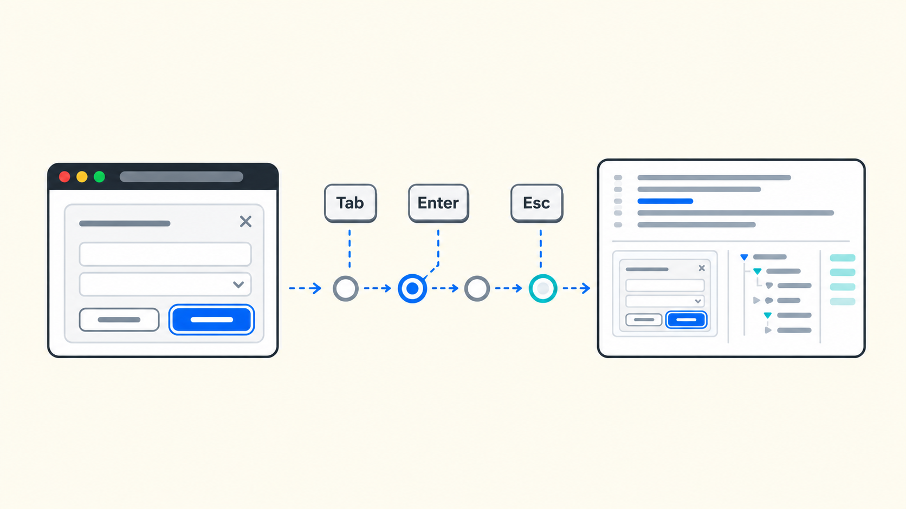

<p align="center">
  
</p>

<h1 align="center">A11y Journey Evidence</h1>

<p align="center">
  <strong>Reviewable keyboard and focus evidence for native Playwright Test journeys</strong>
</p>

<p align="center">
  <a href="https://www.npmjs.com/package/a11y-journey-evidence/v/0.1.0"></a>
  <a href="https://playwright.dev/docs/intro"></a>
  <a href="https://github.com/Light2288/a11y-journey-evidence/blob/main/LICENSE"></a>
</p>

<p align="center">
  <a href="https://light2288.github.io/a11y-journey-evidence/">Documentation</a> ·
  <a href="https://www.npmjs.com/package/a11y-journey-evidence">npm</a> ·
  <a href="https://github.com/Light2288/a11y-journey-evidence/releases/tag/v0.1.0">v0.1.0 release</a>
</p>

## About

**A11y Journey Evidence** adds an opt-in fixture and reporter to Playwright Test. It collects bounded keyboard/focus observations, native assertion outcomes, and available failure artifacts into a portable Markdown bundle. You keep native `page.keyboard`, locators, `test.step`, `expect`, and fixture composition.

**Experimental v0.1.0. External validation pending.** You choose the assertions and expected focus policies. The package does not run screen readers or establish accessibility conformance.

## Features

- **Opt-in recording:** Start once after page setup; unselected tests produce no journey evidence.
- **Native outcomes:** Keep actual/expected status, executed assertions, retries, and repeats visible without replacing Playwright's reporters.
- **Failure captures:** Independently control page screenshots and declared-root ARIA snapshots; unavailable captures and incomplete evidence remain explicit.
- **Portable reports:** Share the whole run directory with relative artifact links and available native traces.
- **Runnable comparisons:** Explore correct dialog/form journeys and isolated regressions through equivalent package and stock Playwright examples.

## Install and get started

In an existing **ESM Playwright project**, install the published package and its tested peer:

```sh
npm install --save-dev a11y-journey-evidence@0.1.0 @playwright/test@1.64.1
npx playwright install chromium
```

The package baseline was verified with Node **24.21.0**, npm **11.19.0**, TypeScript **7.0.2**, Playwright **1.64.1**, Chromium **156.0.8078.4**, and macOS **27.0.1 arm64**. Other package hosts, browsers, and package CI compatibility remain unverified. Documentation CI has separate verification coverage.

Starting from an empty directory? Follow the [complete file-by-file setup](https://light2288.github.io/a11y-journey-evidence/getting-started.html), including its ESM manifest and TypeScript configuration. npm supplies the compiled distribution; GitHub release source archives are repository snapshots.

### Configure reporters

Add the evidence reporter alongside native reporters in `playwright.config.ts`. For a new configuration:

```ts
import { defineConfig } from '@playwright/test';

export default defineConfig({
  testDir: './tests',
  reporter: [
    ['list'],
    ['html', { open: 'never' }],
    ['a11y-journey-evidence/reporter', {
      outputDir: 'a11y-evidence',
      reproductionCommand: 'npx playwright test',
    }],
  ],
  use: { browserName: 'chromium', trace: 'on' },
});
```

### Record a native journey

Save the [complete released synthetic dialog fixture](https://github.com/Light2288/a11y-journey-evidence/blob/v0.1.0/examples/shared/dialog.ts) as `tests/dialog.ts`, then save this as `tests/dialog.spec.ts`:

```ts
import { expect } from '@playwright/test';
import { test } from 'a11y-journey-evidence';
import { loadDialog } from './dialog.js';

test('keyboard opens preferences', async ({ page, journey }) => {
  await loadDialog(page, 'correct');
  await journey.start({ root: page.locator('#dialog') });

  await test.step('Keyboard activation and initial focus', async () => {
    await page.keyboard.press('Tab');
    await expect(page.getByRole('button', { name: 'Open preferences' })).toBeFocused();
    await page.keyboard.press('Enter');
    await expect(page.getByRole('dialog', { name: 'Preferences' })).toBeVisible();
    await expect(page.getByRole('button', { name: 'Continue', exact: true })).toBeFocused();
  });
});
```

```sh
npx playwright test
npx playwright show-report
```

The reporter prints `a11y-evidence/<run-id>/report.md`; the default native HTML report is `playwright-report/index.html`. This passing example verifies activation and initial focus. The [complete dialog recipe](https://light2288.github.io/a11y-journey-evidence/recipes/dialog.html) adds both containment boundaries, Escape dismissal, and focus restoration.

## Integrate with existing fixtures

Compose the package fixture with your own using native `mergeTests`. In your shared fixture file, where `existing-fixtures.ts` already exports your existing `test`:

```ts
import { mergeTests } from '@playwright/test';
import { test as existingTest } from './existing-fixtures.js';
import { test as evidenceTest } from 'a11y-journey-evidence';

export const test = mergeTests(existingTest, evidenceTest);
export { expect } from '@playwright/test';
```

Import that composed `test` in your tests. Request `journey`, finish navigation/content setup, then call `start` once before the behavior being observed. For groups, use ordinary `beforeEach` setup and start once per test after page setup. No per-action recording calls are needed.

| `start` option | Default | Meaning |
| --- | --- | --- |
| `root` | Required | Unambiguous native locator in the fixture page's main light-DOM document, used for scoped ARIA capture |
| `screenshots` | `true` | Attempt a page screenshot on an actual failure visible at teardown |
| `ariaSnapshots` | `true` | Independently attempt the declared-root ARIA snapshot on an actual failure |
| `maxObservations` | `1000` | Integer from 1 to 10000; overflow is disclosed as incomplete |

A root may mount later. Ambiguity is never silently reduced to the first match; a missing root never becomes a whole-document snapshot. Tests that never request `journey` are omitted; requesting it without `start` is reported as incomplete. Navigation/document replacement during observation is unsupported.

See [fixture composition and capture controls](https://light2288.github.io/a11y-journey-evidence/guide/integration.html) and the [API/lifecycle reference](https://light2288.github.io/a11y-journey-evidence/reference/api.html) for exports, reporter options, bounds, and configuration errors.

## Examples and evidence

The [dialog recipe](https://light2288.github.io/a11y-journey-evidence/recipes/dialog.html) declares activation, initial focus, both containment boundaries, dismissal, and restoration. The [form recipe](https://light2288.github.io/a11y-journey-evidence/recipes/form.html) declares invalid-submit error associations, first-invalid-field focus, correction, and resubmission. These are explicit example policies; DOM semantics do not prove a screen reader announces an error.

Each repository demo contains two correct cases and four deliberately broken variants. Commands succeed when correct cases pass and broken cases fail their intended assertions. Playwright may summarize all six expected cases as passed, while the evidence retains the four **actual failed assertions**. An unexpected pass fails the run; regression verification also rejects unrelated failures.

For examples of what a failure reveals, read the inspected synthetic [dialog walkthrough](https://light2288.github.io/a11y-journey-evidence/evidence/dialog.html) and [form walkthrough](https://light2288.github.io/a11y-journey-evidence/evidence/form.html).

### Read and share a bundle

Reports keep native actual/expected status, attempts, executed assertions, and completeness separate. A test can pass with incomplete evidence. No executed assertions means no verified behavioral checks; after an early failure, only executed checks appear. Browser-event sequences and native-step sequences remain separate and do not establish a shared clock or causation.

Screenshots and snapshots describe **fixture-teardown state**, which may differ from assertion-time state. Closed pages, lost roots, empty snapshots, capture errors, truncation, and later teardown failures are disclosed. Capture limitations do not rewrite native outcomes. Missing/corrupt handoff or bundle/report-write failures make an otherwise successful run fail, with diagnostics; hard process termination can prevent finalization.

Move the **whole run directory**, including `assets`, to share a bundle. Its Markdown explanation works without a hosted viewer or trace. Available native traces are copied; trace recording remains Playwright's responsibility. Read the [evidence interpretation guide](https://light2288.github.io/a11y-journey-evidence/evidence/reading.html) for details.

## Limits and application data

Supported scope is **Chromium, one page/main document, ordinary light DOM**, and the explicit observed journey. Frames, new pages, shadow traversal, navigation/document replacement, nested dialogs, additional patterns/browsers, and custom matcher interpretation are outside the verified scope. Detection of unsupported boundaries is best-effort.

The observer retains Tab, Shift+Tab, Enter, Escape, and relevant Space events. Printable input history and field values are excluded from observations; Space inside text-editing targets is suppressed. Focus descriptors retain local references, tags, and bounded allowlisted raw attributes, rather than computed names or continuous state tracking.

**Artifacts can still contain application data.** Titles, diagnostics, labels/attributes, screenshots, ARIA snapshots, and traces are not generally sanitized. Capture controls are independent and do not sanitize other artifacts. Start with synthetic data and inspect the whole bundle before sharing.

DOM focus, accessible descriptions, ARIA structure, and screenshots do not establish screen-reader announcements, focus-indicator quality, inclusive usability, accessibility conformance, or complete keyboard coverage. See the [data and compatibility limitations](https://light2288.github.io/a11y-journey-evidence/limitations.html), [observation/diagnostic bounds](https://light2288.github.io/a11y-journey-evidence/reference/api.html#observation-bounds), and [troubleshooting](https://light2288.github.io/a11y-journey-evidence/troubleshooting.html).

## Repository development

Use the tested Node/npm versions above. From a checkout:

```sh
npm ci
npx playwright install chromium
npm test
npm run demo:package
npm run demo:stock
npm run verify:consumer
```

Use native filters to reproduce form failures:

```sh
npm run demo:package -- --grep "form missing-error-association"
npm run demo:stock -- --grep "form missing-error-association"
npm run demo:package -- --grep "form failed-error-focus"
npm run demo:stock -- --grep "form failed-error-focus"
```

| Repository output | Location |
| --- | --- |
| Package Markdown | `a11y-evidence/<run-id>/report.md` (printed by the command) |
| Native package HTML | `.artifacts/package-html/index.html` |
| Stock HTML / native JSON | `.artifacts/stock-html/index.html` / `.artifacts/stock-native.json` |
| Packed consumer / verification | `.artifacts/consumer/` / `.artifacts/consumer-verification.json` |

Open native reports with `npx playwright show-report .artifacts/stock-html` or the package folder. Both demos enable native traces. Stock attaches observed focus, a screenshot, a scoped ARIA snapshot, and capture timing to actual failures.

`npm run build` compiles ESM JavaScript and declarations. `npm run typecheck`, `npm run test:unit`, and `npm run test:browser` check types, Node tests, and Chromium integration respectively. Generated outputs stay ignored.

### Verify a local tarball

```sh
npm run build
mkdir -p .artifacts/package
npm pack --pack-destination .artifacts/package
```

Install the generated tarball in another ESM project with `npm install --save-dev /absolute/path/to/a11y-journey-evidence-0.1.0.tgz @playwright/test@1.64.1`. The tested-toolchain and data limitations still apply.

`npm run verify:consumer` installs the packed artifact in a fresh external copy of the [minimal consumer](https://github.com/Light2288/a11y-journey-evidence/tree/main/examples/consumer), checks types, fixture composition, native/evidence reporter coexistence, and portable links. Two correct selected journeys produce evidence; an unselected control does not. Integration imports installed files rather than repository source.

### Develop the documentation

The English documentation uses VitePress, standard-theme navigation, and local search:

```sh
npm run docs:dev
npm run docs:build
npm run docs:preview
npm run docs:test
npm run docs:test:unit
npm run docs:check
npm run docs:verify-examples
```

Production preview is `http://localhost:4173/a11y-journey-evidence/`. Build before `docs:test`; `docs:check` runs verifier unit checks, a production build, and Chromium site checks. `docs:verify-examples` installs npm 0.1.0 in a fresh temporary ESM project and verifies seven cases, fixture composition, and native/evidence reports; outputs remain under `.artifacts/docs-examples/`. Documentation tooling and images stay outside the npm distribution.

A small theme extension labels the search field and restores focus on dismissal. Keep its browser regressions when upgrading VitePress. Documentation PR checks use read-only permissions; a user-merged main push uploads only `site/.vitepress/dist/` and deploys through the `github-pages` environment. Pages uses **GitHub Actions**. Documentation CI does not broaden package compatibility claims.

After deployment, inspect the `Documentation` run and public `build-info.json`. Set `DOCS_BASE_URL` to the public site and `DOCS_EXPECTED_COMMIT` to the verified deployment SHA, then run `npm run docs:test -- --grep live`. Keep local `docs:check` for full publication-boundary checks.

## Findings and release history

The [stock Playwright comparison](https://light2288.github.io/a11y-journey-evidence/comparison.html) is an **author assessment**. Native reports and traces already offer substantial capabilities; the package adds another evidence presentation with its own integration and review costs. **External validation is pending**; no measured time savings or external endorsement is claimed.

v0.1.0 includes both dialog and form batches and the Space-key correction. Historical records retain their original findings:

- Dialog: [comparison](https://github.com/Light2288/a11y-journey-evidence/blob/main/docs/batch-1-comparison.md) and [results](https://github.com/Light2288/a11y-journey-evidence/blob/main/docs/batch-1-results.md).
- Form: [comparison](https://github.com/Light2288/a11y-journey-evidence/blob/main/docs/batch-2-comparison.md), [results](https://github.com/Light2288/a11y-journey-evidence/blob/main/docs/batch-2-results.md), and [specification](https://github.com/Light2288/a11y-journey-evidence/blob/main/docs/superpowers/specs/2026-10-27-batch-2-form-package-comparison.md).
- [Space-key fix results](https://github.com/Light2288/a11y-journey-evidence/blob/main/docs/space-key-observation-fix-results.md), including the limits of editability filtering and rich-text-editor support.

## License

[MIT](https://github.com/Light2288/a11y-journey-evidence/blob/main/LICENSE).
